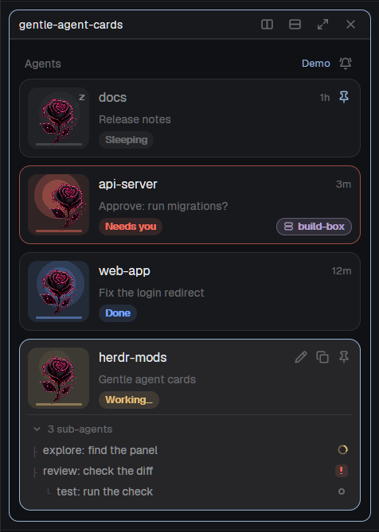

# Gentle Agent Cards

A Herdr app mod (`gentle-agent-cards`) that draws the agents list of the sidebar as cards, each with the Gentle Shell flower that acts out the status, in the spirit of [Agent Cards](https://github.com/dougcunha/herdr-mods/tree/main/agent-cards-app).

## Install

Copy and paste this prompt to your LLM agent:

`Read ~/.config/herdr-app/AGENTS.md, then add this mod: https://github.com/Pacoaldev/gentle-agent-cards/tree/main/mods/gentle-agent-cards`

The [Dock](https://github.com/dougcunha/herdr-mods/tree/main/dock-app) layout (`main-dock`) shows it in its `agents` block. It reads the icons of the `workspace-chrome` mod (`server.svg`, `spinner.svg`, `pin.svg`, `pin-off.svg`, `chevron-down.svg`, `chevron-right.svg`), so install that mod too. Two buttons appear only when their mod is installed: **rename** needs `tab-namer`, **duplicate** needs `kanban`.

## What it shows

The head "Agents" with "N active · M" and the bell button on the right, then one card for each agent. A card shows the agent's program icon, the space name, the time since the last status change, the tab name (or the agent's title when nobody named the tab), and the status pill. An agent on another machine shows the machine name after the pill.

| Status | The flower | The pill |
| --- | --- | --- |
| Working | The petals breathe fast, the heart pulses over a darker ring and the blossom bobs while a small flower glyph turns. | `Working...` (the dots animate) |
| Sleeping | The petals fold small, the whole flower breathes slowly (3.2 s) and three "z" rise and fade. | `Sleeping` |
| Needs you | Big petals pulse fast (400 ms) and the blossom shakes left and right. | `Needs you` |
| Done | The petals bloom wide and the blossom jumps. | `Done` |
| Waiting | A drop falls over the flower while it sways. | the agent's own status |

- The order is Herdr's own: pinned first, then blocked, done, working and idle (a card counts its most urgent sub-agent), then the most recent change. `agent.next` follows it.
- A click on a card runs `pane.focus`. A click on a sub-agent row runs `terminal.peek`; a click on the "N sub-agents" head folds the rows.
- Put the pointer on a card for the **pin** button (it replaces the time; a pinned card always shows it in `accent`). A click runs `terminal.pin`.
- A sidebar narrower than 160px shows a rail: the number and a status dot of each agent.

## Needs you first

`gentle-agent-cards.needsYouFirst` (a `bool` in `kit.json`, off by default) puts the agents whose own status is `blocked` at the top of the panel and the other agents at the bottom, under the line "Other agents". The bell button of the head flips it, and so does the command `gentle-agent-cards.needs-you`.

## Commands

| Command | What it does |
| --- | --- |
| `gentle-agent-cards.demo` | Shows one example card for each status, with sub-agents and a pin. The next run shows the real agents again. |
| `gentle-agent-cards.needs-you` | Flips **Needs you first**. |

## Develop

- `herdr-app check mods/gentle-agent-cards` loads the mod once and reports what is wrong.
- Saving any file of the mod reloads it in place; a broken save keeps the old version running and shows in `herdr-app status`.
- `herdr-app do gentle-agent-cards.demo` needs the mod loaded in a pane: a `place: "none"` mod registers its commands only when a pane instantiates it. Wait 2 s between two commands, or the second one is lost.
- [RECIPE.md](RECIPE.md) has the build: the geometry of the 64px stage, the motion of each status, and the pitfalls of the kit.

## Credits

- `mods/gentle-agent-cards/rose.png` is the Gentle Shell brand rose of [Gentle-AI](https://github.com/gentle-shell/gentle-ai) (`docs/assets/brand/rose.png`).
- `mods/gentle-agent-cards/needs-you.svg` is the bell-ring icon of [Lucide](https://lucide.dev) (ISC license).
- In the spirit of [Agent Cards](https://github.com/dougcunha/herdr-mods/tree/main/agent-cards-app) by Douglas Cunha.

  

## License

MIT. See [LICENSE](LICENSE).
