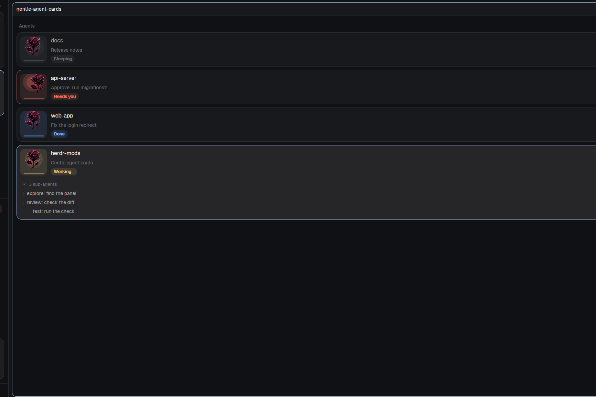

# Gentle Agent Cards

A Herdr app mod (`gentle-agent-cards`) that draws the agents list of the sidebar as cards, each with the Gentle Shell flower that acts out the status, in the spirit of [Agent Cards](https://github.com/dougcunha/herdr-mods/tree/main/agent-cards-app). A layout shows it in its `agents` block.

## What you see

The head "Agents" (11.5px, `dim`) with "N active · M" and the bell button on the right, then one card for each agent, 8px apart, 10px from the sides. A card is 12px radius, 8px padding, `surface` (`selected` when focused), 1px `border` (`accent` when focused, `blocked` at 60% when blocked). On its left, a 64px stage (10px radius, the status color at 12%) with the Gentle Shell flower drawn with `div`s: four petals around a lighter heart, a stem with two leaves, and a ground line, all in the status color. On its right: the agent's program icon (14px), the space name (medium), the time since the last status change (11px, `dim`); the tab name or the agent's title (11.5px, `dim`); a status pill (18px, the status color at 13%): `Working...` (the dots animate), `Sleeping`, `Needs you`, `Done`. An agent on another machine shows the machine name after the pill.

## How it behaves

- The flower acts out the status. `working`: the petals breathe fast (900 ms), the heart pulses over a darker ring and the blossom bobs while a small flower glyph turns above it. `idle`: the petals fold small, the whole flower breathes slowly (3.2 s) and three "z" rise and fade. `blocked`: big petals pulse fast (400 ms) and the blossom shakes left and right (260 ms). `done`: the petals bloom wide (1.4 s) and the blossom jumps (700 ms). `waiting` (an agent's own raw status): a drop falls over the flower while it sways. All of it is `loop` and `spin`: no timer redraws the mod (only a 30 s timer for the times).
- The cards are in the order of Herdr's list: pinned first, then blocked, done, working, idle (a card counts its most urgent sub-agent), then the most recent change. The mod calls `setAgentOrder` with that order, so `agent.next` follows it. A click on a card runs `pane.focus`.
- **Pin.** With the pointer on a card, a pin button replaces the time; a pinned card always shows it in `accent`. A click runs `terminal.pin {terminal, pinned}`.
- **Rename.** When `mods/tab-namer/mod.json` exists (checked at start and every 60 s with `readTextFile`), the pointer on a card also shows a pencil before the pin. A click opens the [Tab Namer](https://github.com/dougcunha/herdr-mods/tree/main/tab-namer-app) dialog: `openOverlay({ mod: "tab-namer", kind: "dialog", width: 460, props: { tab, terminal } })`.
- **Duplicate.** When `mods/kanban/mod.json` exists, the pointer on a card shows the copy button too. A click opens the duplicate menu of the kanban mod: `openOverlay({ mod: "kanban", kind: "popup", width: 270, height: 92, props: { part: "clone-menu", title, address } })`.
- **Sub-agents.** A card with live sub-agents (`terminals()` with `parent`) shows, under a line, the head "N sub-agents" with a chevron, and one 22px row for each: `├` or `└` (14px more indent for each level), the program icon, the name, and a mark (a turning ring for working, `!` for blocked, a dot or a ring). A click on a row runs `terminal.peek`. A click on the head folds the rows; folded, it shows the mark of the most urgent one.
- A sidebar narrower than 160px shows a rail: the number and a status dot of each agent.
- **Needs you first.** `shared("gentle-agent-cards.needsYouFirst")` (`true` is on; absent is off), a `bool` in `kit.json`. The bell button of the head (`needs-you.svg`, the Lucide bell-ring, 13px) flips it, and so does the command `gentle-agent-cards.needs-you`. On, the agents whose own status is `blocked` sort first, and the list is: the blocked cards, a `flex_1` space, the line "Other agents" (only when both parts have cards), and the other cards.
- `herdr-app do gentle-agent-cards.demo` shows one example card for each status, with sub-agents and a pin; the next run shows the real agents again.

## Built from

- `mods/gentle-agent-cards/`, `mod.json` `{ "place": "none", "title": "Gentle Agent Cards" }`. `main.js` builds the list (`agents()`, `terminals()`, `panes()`, `spaces()`, `layout()`, `setAgentOrder`, `nextCommand`, `run`); the name and detail of a card come from the same rules as Herdr's `agents` mod (the tab name, or the agent's title when nobody named the tab). `flower.js` draws the stage: the Gentle Shell rose (`gentle-logo-rosa.svg`, cropped vector `viewBox="238 78 806 1052"`) drawn at 40x52 over a counter-phase two-disc breathing halo of the status color, with native `loop` animations and particles per status (bob + rising pollen sparks, slow breath + swaying "z"s, centered shake + fast alert halo + side sparks, celebration jump + wide bloom + sparks, sway + falling drop); every part is an `absolute()` box in a `relative()` 64px square, and a moving part is a box whose `top`, `left`, `width`, `height` or `opacity` is a `loop`; a breathing disc pins its midpoint once (`HALO_CX - mid/2`, `HALO_CY - mid/2`) and loops only `width`/`height`/`opacity`, because a `loop` on `left`/`top` reads at 0,0 until its first tick. All UI icons (`needs-you.svg`, `server.svg`, `spinner.svg`, `pin.svg`, `pin-off.svg`, `chevron-down.svg`, `chevron-right.svg`, `pencil.svg`, `copy.svg`, all [Lucide](https://lucide.dev), ISC license) are bundled inside `mods/gentle-agent-cards/` so the mod runs standalone without requiring `workspace-chrome`.
- `kit.json` lists the **Needs you first** setting for the mods-hub.
- Commands: `pane.focus`, `terminal.pin`, `terminal.peek`. No program, no file outside its own folder checks, no network.

## Watch out

- A theme color may be missing (`theme()` has no `background` on some setups): never pass a raw `t.x` color to `bg()` in a shared part; fall back (`t.x ?? t.chrome ?? "#f095c8"`). An `undefined` color surfaces later as "child(value) expects an element" with a stack that points at minified lines, not your source.
- When a mod view fails to render, the pane keeps the failed version and the banner "This view could not be re-rendered" sticks even after you fix the file: close the pane and split it again (`pane.split {direction, mod}`). Mod render errors show only in the UI; `herdr-server.log` has nothing about them. Instrument the stage with a `try/catch` that renders `e.stack` as text to see the real error.
- `herdr-app do <mod>.demo` needs the mod loaded in a pane: a `place: "none"` mod registers its commands only when a pane instantiates it. Split a pane with the mod first.
- `loop("top")` sets `top` itself: give the moving box no `top`, and put its two positions in `from` and `to`. One element takes one `loop` for each property; a "z" that rises and fades is an outer `loop("top")` with an inner `loop("opacity")`.
- A breathing disc pins its place with static `left`/`top` (`HALO_CX - d/2`, `HALO_CY - d/2`) and loops only `width`/`height`/`opacity`. A `loop` on `left`/`top` reads at 0,0 until its first tick, so the disc grows out of the top-left corner; the ~2px drift of the center from `d1` to `d2` is invisible on a 64px stage.
- The rose asset is Gentle Shell's own brand image: credit Gentle-AI (gentle-shell/gentle-ai, `docs/assets/brand/rose.png`) when you share the mod.
- The Dock tab bar replaces the block's mod, not the block: keep the id `agents`, because the tab bar looks it up.
- Write `mod.json` before `main.js` in a new mod folder, or Herdr docks a copy of the mod into the shown layout.
- Untested: macOS, Linux, a remote machine's window, layouts other than `main-dock`.

## Done when

- `herdr-app check ~/.config/herdr-app/mods/gentle-agent-cards` passes. `herdr-app do gentle-agent-cards.demo` shows 4 cards (Needs you, Done, Working, Sleeping), and `herdr-app shot` shows the flowers.
- With the demo on, `herdr-app do gentle-agent-cards.needs-you` moves the "Needs you" card to the top, and the line "Other agents" with the other 3 cards to the bottom. The next run shows the normal order again. Wait 2 s between 2 commands: a command sent at once after another one is lost.
